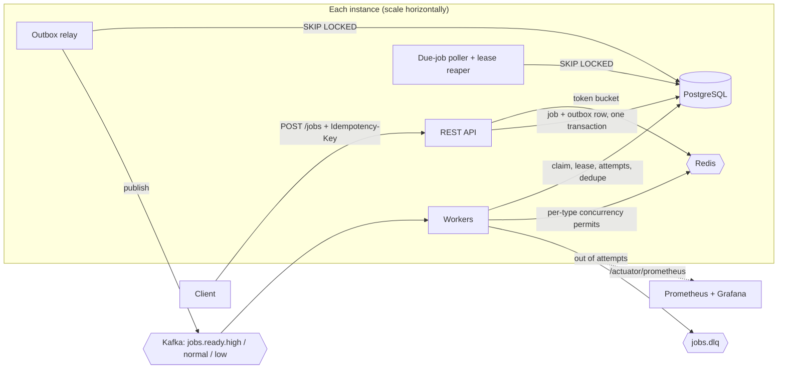

# Distributed Job Scheduler

A distributed job queue built with Java 21, Spring Boot 3.5, PostgreSQL, Kafka and Redis.

## What it does

Clients submit jobs over a REST API. A job can run right away, at a set time, or on a cron schedule, and a pool of workers spread across any number of instances runs it.

- **Reliable delivery.** Once the API accepts a job, the job is not lost, even if Kafka or a worker goes down.
- **Retries with backoff.** Failed attempts are retried with exponential backoff and jitter. A job that runs out of attempts is sent to a dead-letter topic, and you can replay it later.
- **Crash recovery.** Workers hold a lease on each job they run. If a worker dies, its lease expires and another worker picks the job up.
- **Idempotency.** Repeating a request with the same `Idempotency-Key` returns the original job instead of creating a duplicate. Redelivered Kafka messages are ignored.
- **Rate limiting.** Each tenant gets a token bucket, and requests over the limit get `429` with `Retry-After`.
- **Concurrency caps.** You can limit how many jobs of one type run at once across the whole cluster, for example at most 5 `send-email` jobs.
- **Priorities.** HIGH, NORMAL and LOW jobs use separate queues, so a backlog of bulk work never delays urgent jobs.
- **Observability.** Prometheus metrics, a ready-made Grafana dashboard, and structured logs tagged with the job id.

## Architecture



Each component does one job:

- **PostgreSQL** is the source of truth for every job: its status, schedule, attempts and lease.
- **Kafka** carries "this job is ready to run" messages to workers. Each priority has its own topic, and all instances share one consumer group, so each message goes to exactly one worker.
- **Redis** holds the per-tenant rate limits, the per-type concurrency permits, and a cache of idempotency keys.

### How a job flows

1. **Submit.** The API checks the tenant's rate limit and the `Idempotency-Key`. In one Postgres transaction it then saves the job and, if the job is due now, an **outbox** row.
2. **Publish.** The outbox relay sends outbox rows to Kafka and marks them sent. The job and its message are written together, so they can never disagree.
3. **Wait.** Delayed jobs, retries and cron occurrences wait in Postgres until their `run_at`. Then the poller queues them.
4. **Run.** A worker claims the job with a conditional `UPDATE`, which only one worker can win. It takes a lease, runs the handler, and renews the lease while the handler runs.
5. **Finish.** On success the job becomes `SUCCEEDED`. On failure it becomes `RETRYING` with backoff, or `FAILED` when no attempts are left, and in that case it's published to the dead-letter topic. For a cron job, the next occurrence is created.
6. **Recover.** If a worker stops renewing its lease, the reaper takes the job back and retries it.

The poller, relay and reaper lock rows with `FOR UPDATE SKIP LOCKED`, so every instance can run them at once without a leader.

```
PENDING ──due──▶ QUEUED ──claim──▶ RUNNING ──▶ SUCCEEDED
                                      │
                                      ├─ attempts left ──▶ RETRYING ──due──▶ QUEUED
                                      └─ none left ──────▶ FAILED ──▶ dead-letter topic (replayable)

PENDING / QUEUED / RETRYING ──cancel──▶ CANCELLED
```

[docs/DESIGN.md](docs/DESIGN.md) explains the reasoning behind each design choice and has load-test results.

## Running the project

### Prerequisites

- Java 21
- Docker with Docker Compose

### 1. Start the infrastructure

```bash
docker compose up -d
```

This starts PostgreSQL, Redis, Kafka, Kafka UI, Prometheus and Grafana.

### 2. Start the scheduler

```bash
./mvnw spring-boot:run
```

On Windows, use `mvnw.cmd spring-boot:run`. The app listens on http://localhost:8080 and creates its database tables on startup.

| What | Where |
| --- | --- |
| API docs (Swagger UI) | http://localhost:8080/swagger-ui.html |
| Grafana dashboard | http://localhost:3000 |
| Prometheus | http://localhost:9090 |
| Kafka UI | http://localhost:8081 |
| PostgreSQL | `localhost:5433`, user and password `scheduler` |

### 3. Submit some jobs

```bash
# Run now, retrying up to 5 times
curl -X POST localhost:8080/jobs -H 'Content-Type: application/json' -H 'X-Tenant-Id: acme' \
  -H 'Idempotency-Key: order-42-receipt' \
  -d '{"type": "send-email", "payload": {"to": "a@example.com"}, "maxAttempts": 5, "priority": "HIGH"}'

# Run at a specific time
curl -X POST localhost:8080/jobs -H 'Content-Type: application/json' \
  -d '{"type": "noop", "runAt": "2026-12-01T09:00:00Z"}'

# Run every 5 minutes (6-field cron with seconds first, in UTC)
curl -X POST localhost:8080/jobs -H 'Content-Type: application/json' \
  -d '{"type": "noop", "cron": "0 */5 * * * *"}'

# Check on a job and its attempts
curl localhost:8080/jobs/<id>
curl localhost:8080/jobs/<id>/attempts
```

| Method | Path | Description |
| --- | --- | --- |
| `POST` | `/jobs` | Submit a job |
| `GET` | `/jobs/{id}` | Get a job |
| `GET` | `/jobs?status=FAILED` | List jobs, newest first |
| `GET` | `/jobs/{id}/attempts` | Attempt history |
| `POST` | `/jobs/{id}/cancel` | Cancel a job that hasn't started |
| `POST` | `/jobs/{id}/replay` | Re-run a failed job |

Requests are scoped to a tenant through the `X-Tenant-Id` header, which defaults to `default`.

The built-in job types are `noop`, `sleep`, `send-email` (fails 10% of the time), `flaky` (fails the first few attempts) and `always-fail`. To add a new type, write a Spring bean that implements `JobHandler`.

### Run more instances

Start a second instance on another port. It joins the same consumer group and takes over half the work:

```bash
SERVER_PORT=8082 HOSTNAME=node-2 ./mvnw spring-boot:run
```

You can also run everything in Docker, with three extra workers:

```bash
docker compose --profile app up -d --build --scale worker=3
```

### Run the tests

```bash
./mvnw verify
```

The integration tests start real PostgreSQL, Kafka and Redis containers with Testcontainers, so Docker must be running.

### Run a load test

With [k6](https://k6.io) installed:

```bash
k6 run -e RATE=200 -e DURATION=60s -e RUN_ID=my-run loadtest/submit-jobs.js
docker compose exec -T postgres psql -U scheduler -v run_id="'my-run'" -f - < loadtest/report.sql
```

### Stop everything

```bash
docker compose down        # keeps the data
docker compose down -v     # also deletes the data
```
