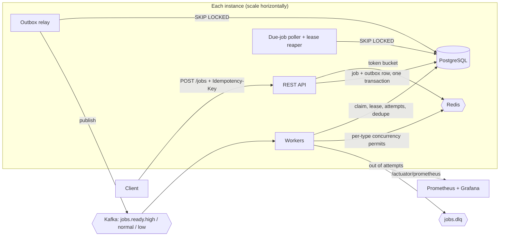

# Distributed Job Scheduler

A job queue where clients submit work over HTTP and it runs now, later, or on a cron schedule on a pool of workers. Failed jobs retry with backoff, and jobs that keep failing go to a dead-letter topic. Duplicate requests and duplicate messages are ignored, and each tenant is rate limited. Any number of instances can run side by side with no leader.

Built with Java 21, Spring Boot 3.5, PostgreSQL 16, Kafka 3.9 and Redis 7.



## How a job flows

1. **Submit.** `POST /jobs` checks the tenant's rate limit in Redis and the `Idempotency-Key`. In one Postgres transaction it then inserts the job and, if the job is already due, an **outbox** row.
2. **Publish.** The outbox relay reads unpublished rows with `FOR UPDATE SKIP LOCKED`, publishes them to the Kafka topic for the job's priority, and marks them sent.
3. **Wait.** Delayed jobs, retries and cron occurrences wait in Postgres with a `run_at`. The poller moves due jobs to `QUEUED` and writes their outbox rows.
4. **Run.** A worker takes a per-type concurrency permit and records the message id so redeliveries are skipped. It then **claims** the job with a conditional `UPDATE` that also takes a **lease**, runs the handler outside any transaction, and renews the lease while the handler runs.
5. **Finish.** On success the job becomes `SUCCEEDED`. On failure it becomes `RETRYING` with exponential backoff, or `FAILED` when no attempts are left, in which case it is published to `jobs.dlq`. For a cron job, the next occurrence is inserted in the same transaction.
6. **Recover.** If a worker dies, its lease expires and the reaper retries the job or dead-letters it.

```
PENDING ──due──▶ QUEUED ──claim──▶ RUNNING ──▶ SUCCEEDED
   ▲                │                 │
   │ (type at its   │                 ├─ attempts left ──▶ RETRYING ──due──▶ QUEUED
   │  concurrency   │                 └─ none left ──────▶ FAILED ──▶ jobs.dlq
   └─  limit) ──────┘                                         │
                                                  POST /replay┘
PENDING / QUEUED / RETRYING ──cancel──▶ CANCELLED
```

## Design decisions

| Problem | Approach | Why |
| --- | --- | --- |
| Writing the DB and Kafka atomically | **Transactional outbox** | Publishing inside the request can lose messages (Kafka down) or send ghosts (DB rolls back). The outbox row commits with the job, and the relay retries until Kafka has it. |
| Delayed jobs and retry backoff | Wait in **Postgres**, send to Kafka only when due | Kafka has no per-message delay. Retry topics with fixed delays are rigid. A partial index on `run_at` makes the poll cheap. |
| Several schedulers, no leader | `SELECT … FOR UPDATE SKIP LOCKED` | Every instance can poll and relay at once. Each one locks a different batch, so there's no election and no single point of failure. |
| Two workers running the same job | Conditional `UPDATE … WHERE status='QUEUED' AND attempts=:n` | Only one `UPDATE` can match. A late or duplicate message expects a different attempt number and matches nothing. |
| Crashed or hung workers | **Leases** with a heartbeat, plus a reaper | A live worker renews its lease every third of its length. One that stops is presumed dead. If it does come back, its final write is fenced off because it checks `locked_by`. |
| Duplicate HTTP requests | `Idempotency-Key` with Redis in front of a **partial unique index** | Redis answers repeats quickly. Postgres is the guarantee, even if Redis is down or two requests race. Reusing a key with a different body returns `409`. |
| Kafka redelivery (at-least-once) | `processed_messages`, written in the claim transaction | Redelivered message ids are skipped. Combined with the claim fencing, a job's handler effectively runs once per attempt. |
| Noisy tenants | **Token bucket** per tenant in Redis, as an atomic Lua script | It's shared by all API instances and uses Redis's clock, so instance clock skew doesn't matter. Bursts are allowed up to capacity. |
| Fragile downstream services | **Distributed semaphore** per job type (Redis sorted set) | It caps, say, `send-email` at 5 concurrent jobs across the whole cluster. Permits expire, so a crashed worker can't leak one. Deferred jobs don't spend an attempt. |
| Urgent work stuck behind bulk work | One topic and one consumer pool **per priority** | A backlog on `jobs.ready.low` never delays `jobs.ready.high`. |
| Redis outage | Rate limiting and concurrency caps **fail open**; idempotency falls back to Postgres | Redis is an optimization here. Losing it shouldn't stop jobs from being accepted or run. |

**Delivery guarantee.** Jobs are never lost once `POST /jobs` returns, and a job never runs twice at the same time. A job can run more than once only if a worker finishes the work and then crashes before recording success. Handlers should therefore be idempotent, which is the honest guarantee every at-least-once system gives.

## Run locally

Requirements: Java 21 and Docker.

```bash
docker compose up -d          # Postgres, Redis, Kafka, Kafka UI, Prometheus, Grafana
./mvnw spring-boot:run        # API, workers, poller and relay on http://localhost:8080
```

| What | Where |
| --- | --- |
| API docs (Swagger) | http://localhost:8080/swagger-ui.html |
| Grafana dashboard | http://localhost:3000 (no login) |
| Prometheus | http://localhost:9090 |
| Kafka UI | http://localhost:8081 |
| Postgres | `localhost:5433`, user/password `scheduler` |

To run the scheduler in Docker too, with three extra worker instances:

```bash
docker compose --profile app up -d --build --scale worker=3
```

To start a second instance from source, use `SERVER_PORT=8082 HOSTNAME=node-2 ./mvnw spring-boot:run`. It joins the same consumer group and picks up half the partitions.

Use `SPRING_PROFILES_ACTIVE=json` for structured JSON logs (ECS). While a job runs, every log line carries `jobId`, `tenantId` and `jobType`.

## API

Every request is scoped to a tenant by the `X-Tenant-Id` header (default `default`).

| Method | Path | Description |
| --- | --- | --- |
| `POST` | `/jobs` | Submit a job. `201` if new; `200` with `Idempotent-Replayed: true` for a repeated `Idempotency-Key`. `429` with `Retry-After` when over the rate limit. |
| `GET` | `/jobs/{id}` | Fetch a job. `404` if it belongs to another tenant. |
| `GET` | `/jobs?status=FAILED&page=0&size=20` | List jobs, newest first. |
| `GET` | `/jobs/{id}/attempts` | Attempt history: worker, outcome, error, timings. |
| `POST` | `/jobs/{id}/cancel` | Cancel a job that hasn't started. `409` otherwise. |
| `POST` | `/jobs/{id}/replay` | Re-run a `FAILED` job with a fresh set of attempts. |

```bash
# Run once, now
curl -X POST localhost:8080/jobs -H 'Content-Type: application/json' -H 'X-Tenant-Id: acme' \
  -H 'Idempotency-Key: order-42-receipt' \
  -d '{"type": "send-email", "payload": {"to": "a@example.com"}, "maxAttempts": 5, "priority": "HIGH"}'

# Run later
curl -X POST localhost:8080/jobs -H 'Content-Type: application/json' \
  -d '{"type": "noop", "runAt": "2026-12-01T09:00:00Z"}'

# Every 5 minutes (Spring cron: 6 fields, seconds first, evaluated in UTC)
curl -X POST localhost:8080/jobs -H 'Content-Type: application/json' \
  -d '{"type": "noop", "cron": "0 */5 * * * *"}'
```

Errors use RFC 7807 problem responses. Validation errors include an `errors` map of field to message.

### Job types

Add a job type by adding a Spring bean that implements `JobHandler`. The demo handlers are:

| Type | Behaviour |
| --- | --- |
| `noop` | Does nothing. Measures the scheduler's own overhead. |
| `sleep` | Sleeps `payload.durationMs` (default 100). |
| `send-email` | Waits 20–120 ms and fails with probability `payload.failureRate` (default 0.1). Capped at 5 concurrent. |
| `flaky` | Fails the first `payload.failTimes` attempts (default 2), then succeeds. |
| `always-fail` | Always fails. Shows the dead-letter path. |

## Configuration

Everything is under `scheduler.*` in `application.yml`, and each setting can be overridden with an environment variable, for example `SCHEDULER_WORKER_CONCURRENCY_NORMAL=6`.

| Setting | Default | Meaning |
| --- | --- | --- |
| `worker.concurrency.{high,normal,low}` | 4 / 3 / 1 | Consumer threads per priority, per instance |
| `worker.lease-duration` | 30s | How long a silent worker keeps a job |
| `retry.base-delay`, `retry.max-delay` | 1s, 5m | Backoff: base × 2^(attempt−1), capped, with jitter |
| `rate-limit.defaults` | 50 burst, 10/s | Token bucket per tenant; override per tenant under `rate-limit.tenants` |
| `concurrency-limits` | `send-email: 5` | Max running jobs per type, across all workers |
| `outbox.poll-interval-ms`, `poller.interval-ms` | 200, 500 | Relay and poller cadence |
| `outbox.enabled`, `poller.enabled`, `worker.enabled` | true | Turn roles off to run API-only or worker-only instances |

## Tests

```bash
./mvnw verify
```

There are 36 tests. The integration tests run the whole application against real Postgres, Kafka and Redis containers (Testcontainers), and they cover:

- Submit to success, and a duplicate Kafka message not running the job twice
- Retries with backoff, ending in `FAILED` plus a dead-letter message, then replay after the downstream recovers
- A crashed worker's job being reclaimed through its expired lease and finished by another worker
- Delayed jobs not running early, cron jobs scheduling their next occurrence
- Idempotency: repeats, conflicting bodies, per-tenant keys, Redis losing the key, and 10 concurrent identical requests creating exactly one job
- Rate limiting (`429` for one tenant while another is unaffected), a per-type concurrency cap never exceeded, priority routing
- Metrics reaching the Prometheus endpoint

CI runs the same suite on every push and pull request (`.github/workflows/ci.yml`).

## Benchmarks

Run with [k6](https://k6.io) (`loadtest/submit-jobs.js`). End-to-end latency is computed from the database afterwards (`loadtest/report.sql`), measured from job creation to completion. The job type is `noop`, so the numbers show the scheduler's own overhead.

Environment: one 4 vCPU / 16 GB cloud VM running everything (Postgres, Kafka, Redis, the scheduler instances and k6), with `worker.concurrency.normal=6` and `outbox.poll-interval-ms=50`.

| Setup | Submit rate | Jobs completed | Submit p95 | End-to-end p50 | p95 | p99 |
| --- | --- | --- | --- | --- | --- | --- |
| 1 instance | 200 /s for 60 s | 12,001 / 12,001 | 8 ms | 39 ms | 60 ms | 67 ms |
| 1 instance | 500 /s for 60 s | 29,993 / 29,993 | 29 ms | 62 ms | 867 ms | 1,299 ms |
| 2 instances | 500 /s for 60 s | 29,964 / 29,964 | 32 ms | 51 ms | 358 ms | 738 ms |
| 2 instances | 800 /s for 60 s | Saturated: about 570 jobs/s completed while the backlog grew | 184 ms | n/a | n/a | n/a |

All runs had 0 failed requests. With two instances the work split evenly, 15,038 and 14,926 jobs. On this single shared machine the ceiling is about 570 jobs/s, because the scheduler shares four cores with Postgres, Kafka and k6. On separate machines, more instances and partitions would push it further.

To run it yourself:

```bash
k6 run -e RATE=200 -e DURATION=60s -e RUN_ID=my-run loadtest/submit-jobs.js
docker compose exec -T postgres psql -U scheduler -v run_id="'my-run'" -f - < loadtest/report.sql
```

## Project layout

```
src/main/java/com/jobscheduler
  api/            REST controller, request/response records, error mapping
  job/            Job entity and lifecycle rules, JPA repository, JobStore (worker-side SQL)
  idempotency/    Idempotency-Key handling: Redis cache, request hashing, race handling
  queue/          Outbox writer and relay, Kafka topics and error handling, message types
  worker/         Kafka listeners, executor (claim, run, heartbeat, finish), retry policy,
                  per-type concurrency limiter, job handlers
  scheduling/     Due-job poller, lease reaper, cron recurrence, housekeeping
  ratelimit/      Per-tenant token bucket and the interceptor that applies it
  observability/  Micrometer metrics and backlog gauges
src/main/resources/db/migration   Flyway migrations, one per feature
observability/    Prometheus config and the provisioned Grafana dashboard
loadtest/         k6 script and the SQL report
```
